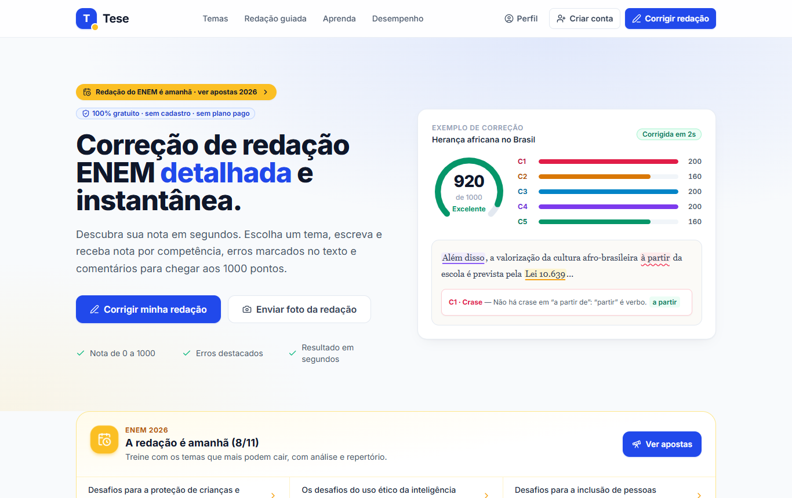
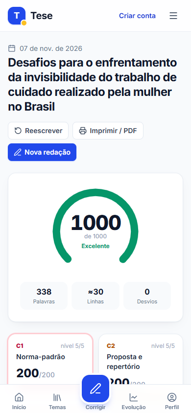
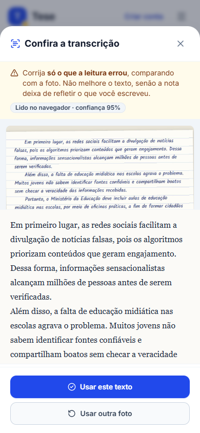
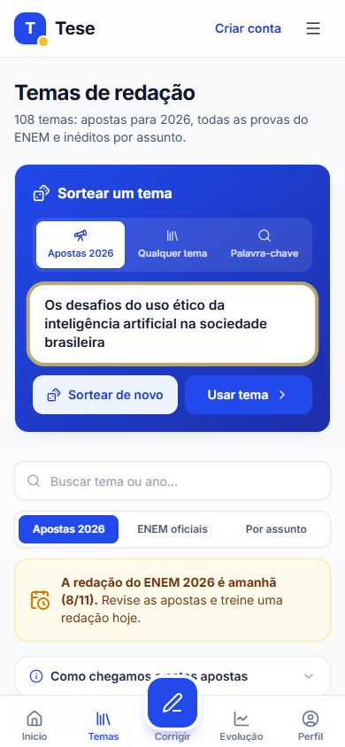
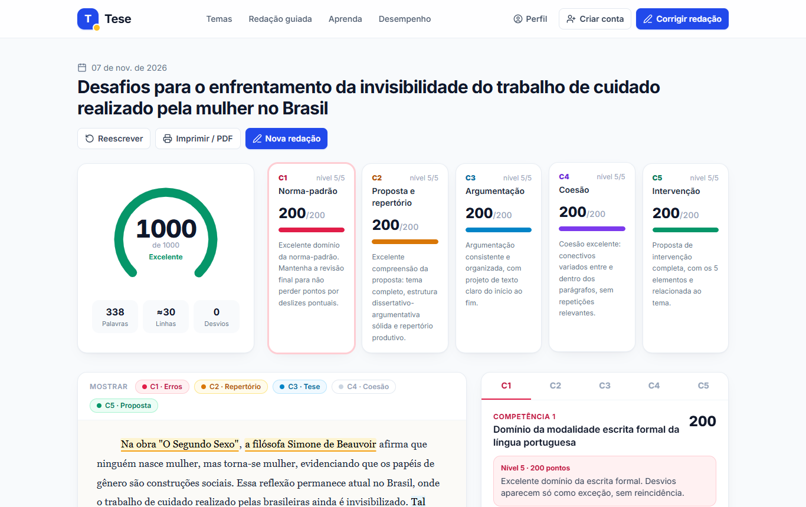
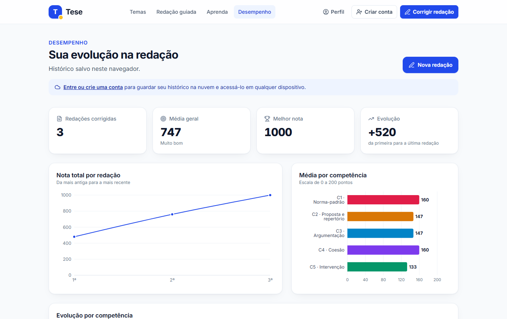

<div align="center">

# ✍️ Tese — Correção de Redação ENEM 100% gratuita

**Escreva ou fotografe sua redação e receba, em segundos, a nota nas 5 competências do ENEM, os erros marcados no texto e comentários para chegar aos 1000 pontos.**

[](https://react.dev)
[](https://vitejs.dev)
[](https://tailwindcss.com)
[](https://supabase.com)
[](#-testes)

**[🌐 Acessar o site](#-site-no-ar)** · [Funcionalidades](#-funcionalidades) · [Como a nota é calculada](#-como-a-nota-é-calculada) · [Rodar localmente](#-rodar-localmente) · [Publicar](#-publicar-na-vercel)



</div>

---

## 💡 O que é

O **Tese** é uma plataforma para estudantes treinarem a redação do ENEM sem pagar nada. Outros corretores online cobram para liberar a correção detalhada. Aqui **todas as funções são gratuitas e ilimitadas**: não há plano pago, período de teste nem cartão de crédito.

A correção roda inteira no navegador, por um motor que aplica os critérios da matriz de referência do INEP. Por isso ela é instantânea e funciona até sem cadastro. Quem cria conta ganha histórico na nuvem, gráficos de evolução e recursos com IA.

> ⚠️ Projeto educacional independente, sem vínculo com o INEP ou o MEC. A nota é uma estimativa para treino; a nota oficial do ENEM é dada por corretores humanos.

## ✨ Funcionalidades

| | Funcionalidade | Detalhes |
|---|---|---|
| 📝 | **Correção nas 5 competências** | Nota de 0 a 1000, nível de cada competência (0 a 200) e critérios de nota zero |
| 🖍️ | **Erros marcados no texto** | Ortografia, acentuação, crase, concordância, pontuação e informalidade, com explicação e sugestão ao clicar |
| 💬 | **Comentários detalhados** | Pontos fortes, o que melhorar e o caminho exato para subir de nível em cada competência |
| 📷 | **Correção por foto** | Fotografe a redação feita no papel; o texto é transcrito e você confere antes de corrigir |
| 🎯 | **Detecção de fuga ao tema** | Diz se o recorte foi abordado por completo, tangenciado ou se houve fuga |
| 🧩 | **Proposta de intervenção** | Verifica os 5 elementos: agente, ação, meio/modo, finalidade e detalhamento |
| 🔮 | **Apostas para o ENEM 2026** | 14 temas prováveis, com justificativa, repertório sugerido e fontes |
| 🎲 | **Sorteio de temas** | Entre as apostas, entre todos os temas ou por palavra-chave, com animação |
| 📚 | **Mais de 100 temas** | Todos os temas oficiais do ENEM de 1998 a 2025 e dezenas de inéditos por assunto |
| 🧭 | **Redação guiada** | Escreva parágrafo por parágrafo, com checklist em tempo real |
| 📈 | **Desempenho e perfil** | Histórico, gráficos por competência, meta de nota, conquistas e sequência de dias |
| 🤖 | **Segunda opinião com IA** *(opcional)* | O Claude corrige como um corretor humano e as duas notas aparecem lado a lado |
| 🎓 | **Curso gratuito** | 9 aulas: estrutura, competências, repertório, mais de 150 conectivos e redação modelo comentada |

### 📱 Feito para o celular

A maioria dos estudantes usa o celular, então o site foi desenhado primeiro para ele. Tem barra de navegação inferior no estilo de aplicativo, painéis que sobem da parte de baixo da tela e botões grandes.

<div align="center">




</div>

### 🖥️ Resultado da correção



### 📊 Evolução



## 🧮 Como a nota é calculada

O motor fica em [`src/engine/`](src/engine/) e aplica a matriz de referência do ENEM. Cada competência recebe 0, 40, 80, 120, 160 ou 200 pontos.

| Competência | O que o motor analisa |
|---|---|
| **C1 · Norma-padrão** | Cerca de 200 erros ortográficos frequentes, acentuação por terminação, cerca de 45 regras de crase, concordância, regência, informalidade e pontuação, mais o [LanguageTool](https://languagetool.org) (API pública e gratuita) |
| **C2 · Proposta e repertório** | Aderência ao recorte do tema (pleno, parcial, tangência ou fuga), estrutura dissertativo-argumentativa e repertório sociocultural (base de cerca de 400 autores, leis, dados, fatos históricos e obras) |
| **C3 · Argumentação** | Tese, anúncio dos argumentos, desenvolvimento dos parágrafos, alinhamento com a introdução e conclusão |
| **C4 · Coesão** | Conectivos entre e dentro dos parágrafos, variedade, coesão referencial e repetições |
| **C5 · Intervenção** | Agente, ação, meio/modo, finalidade, detalhamento e respeito aos direitos humanos |

Ele também aplica os **critérios de nota zero**: texto em branco, até 7 linhas, fuga ao tema, narrativa, impropérios e texto em língua estrangeira.

O motor foi calibrado com redações de teste escritas para isso:

| Redação de teste | Nota obtida |
|---|---|
| Nota 1000 (tema 2023) | 1000 |
| Bem escrita, mas sem repertório | 760 |
| Mediana, com vários erros | 480 |
| Tangencia o tema | C2, C3 e C5 limitadas a 40 |
| Proposta com pena de morte | C5 = 0 |
| Fuga ao tema, narrativa ou até 7 linhas | redação anulada |

## 🛠️ Tecnologias

- **Frontend:** React 18, JavaScript, Vite 5, Tailwind CSS 3, React Router 6
- **Gráficos e ícones:** Recharts e lucide-react
- **Leitura de foto:** Tesseract.js no navegador, ou Claude com visão via Edge Function
- **Contas e banco:** Supabase (Auth, Postgres com Row Level Security, Edge Functions)
- **Testes:** Vitest (38 testes do motor de correção)
- **Automação:** GitHub Actions (robô que mantém o Supabase ativo)

## 🚀 Rodar localmente

Pré-requisito: Node.js 18 ou mais novo.

```bash
git clone https://github.com/brunoalvaress1/tese-redacao-enem.git
cd tese-redacao-enem
npm install
npm run dev      # http://localhost:5173
```

Sem configurar nada, o site já funciona e o histórico fica salvo no navegador. Para ativar as contas, veja a seção abaixo.

| Comando | O que faz |
|---|---|
| `npm run dev` | Servidor de desenvolvimento |
| `npm test` | Roda os testes do motor de correção |
| `npm run build` | Gera a versão de produção em `dist/` |
| `npm run preview` | Abre a versão de produção localmente |

## 🔐 Configurar o Supabase (contas de usuário)

Com o Supabase, cada aluno cria a própria conta e vê só as próprias redações.

1. Crie um projeto grátis em [supabase.com](https://supabase.com).
2. Em **SQL Editor → New query**, cole todo o arquivo [`supabase/schema.sql`](supabase/schema.sql) e clique em **Run**. Ele cria tabelas, regras de segurança (RLS), o gatilho de perfil e a função do robô. Pode rodar mais de uma vez sem problema.
3. Em **Project Settings → API**, copie a *Project URL* e a chave *anon public*.
4. Copie `.env.example` para `.env` e preencha:
   ```env
   VITE_SUPABASE_URL=https://xxxx.supabase.co
   VITE_SUPABASE_ANON_KEY=eyJhbGciOi...
   ```
5. Em **Authentication → URL Configuration**, cadastre a URL do site publicado em *Site URL* e em *Redirect URLs*.

> A chave `anon` é pública e feita para ficar no site; a segurança vem das regras RLS do banco. **Nunca** coloque a chave `service_role` no frontend nem no repositório.

## 🤖 Recursos com IA (opcional)

Duas Edge Functions usam o Claude da Anthropic. Elas só atendem alunos logados e cada aluno tem um limite diário:

| Função | Para que serve |
|---|---|
| [`transcrever-redacao`](supabase/functions/transcrever-redacao/index.ts) | Lê a foto da redação, inclusive letra cursiva |
| [`corrigir-redacao-ia`](supabase/functions/corrigir-redacao-ia/index.ts) | Faz a "segunda opinião": notas, comentários e desvios em formato estruturado |

```bash
supabase login
supabase link --project-ref SEU_PROJECT_REF
supabase secrets set ANTHROPIC_API_KEY=sk-ant-...
supabase secrets set TRANSCRICOES_POR_DIA=20 CORRECOES_IA_POR_DIA=10   # opcional
supabase functions deploy transcrever-redacao
supabase functions deploy corrigir-redacao-ia
```

Sem essas funções, o site continua 100% funcional: a foto é lida no navegador e a correção é a automática.

## ⏰ Robô que mantém o Supabase ativo

O plano grátis do Supabase pausa projetos depois de 7 dias sem uso. O workflow [`.github/workflows/manter-supabase-ativo.yml`](.github/workflows/manter-supabase-ativo.yml) evita isso:

- roda **a cada 5 dias** e chama a função `ping` do banco;
- se o repositório ficar mais de 45 dias sem commits, faz um commit leve, porque o GitHub desliga agendamentos em repositórios parados há 60 dias.

Para funcionar, crie em **Settings → Secrets and variables → Actions** os secrets `SUPABASE_URL` e `SUPABASE_ANON_KEY`. Para testar, use **Actions → Manter Supabase ativo → Run workflow**.

## 🌐 Publicar na Vercel

1. Em [vercel.com/new](https://vercel.com/new), importe este repositório. O framework (Vite) é detectado sozinho.
2. Em **Environment Variables**, adicione `VITE_SUPABASE_URL` e `VITE_SUPABASE_ANON_KEY`.
3. Clique em **Deploy**. O [`vercel.json`](vercel.json) já configura as rotas do app.

A cada `git push` na branch `main`, a Vercel publica a nova versão automaticamente.

## 🌍 Site no ar

> O endereço público aparece aqui depois da publicação na Vercel.

## 📁 Estrutura

```
src/
├── engine/            # motor de correção (C1–C5, tema, gramática) + testes
│   ├── dados/         # regras gramaticais, conectivos, repertório
│   └── __tests__/     # redações de calibração e testes
├── data/              # temas do ENEM, apostas 2026, aulas do curso
├── pages/             # telas: Início, Temas, Escrever, Correção, Desempenho, Perfil, Guiada, Aprenda, Entrar
├── components/        # foto, seletor/folha de tema, texto marcado, segunda opinião, layout…
└── lib/               # Supabase, autenticação, armazenamento, OCR, IA
supabase/
├── schema.sql         # banco completo (cole no SQL Editor)
└── functions/         # Edge Functions de IA
scripts/               # robô keep-alive
docs/screenshots/      # imagens deste README
PROGRESSO.md           # diário de desenvolvimento, testes e avaliações
```

## 🧪 Testes

```bash
npm test
```

Os 38 testes cobrem as regras gramaticais, a aderência ao tema, a calibração das notas, os critérios de nota zero, a limpeza da transcrição de foto, o sorteio por palavra-chave e as apostas de 2026.

## 🙏 Créditos

- [LanguageTool](https://languagetool.org): verificação ortográfica e gramatical em português
- [Tesseract.js](https://tesseract.projectnaptha.com): leitura de texto em imagens no navegador
- [Claude](https://www.anthropic.com): recursos opcionais de IA
- Temas oficiais: provas do ENEM/INEP de 1998 a 2025. Apostas de 2026 baseadas em notícias públicas, com as fontes citadas no próprio site.
